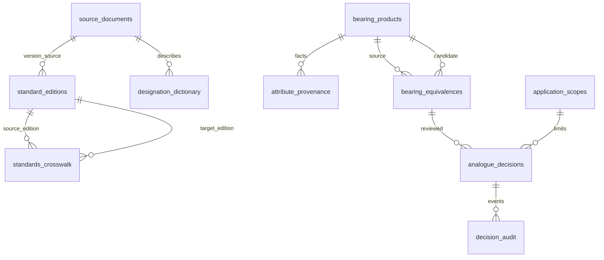

# EVEREST BearingsInfo — инженерная модель v1

**Статус:** проектный модуль, не внедрён в 1С / Bitrix24. 21 модульный тест локально пройден.

## 1. Разделение предметных сущностей

| Сущность | Назначение | Главные ограничения |
|---|---|---|
| `standard_editions` | Реестр конкретных редакций ГОСТ/ISO | `ACTIVE / REPLACED / PROJECT / WITHDRAWN` — хранимые значения с источником статуса и датой проверки, а не константы кода |
| `standards_crosswalk` | Соответствие **двух редакций стандартов** | Только `IDT/MOD/NEQ`, исходный документ, редакции, дата; **не является** разрешением на замену изделия |
| `designation_dictionary` | Коды префиксов, базовых серий и суффиксов | Привязка к бренду, типу подшипника, первоисточнику и версии; FAG ≠ INA по умолчанию |
| `bearing_products` | Исходная маркировка + распознанный паспорт | Отдельные `raw_designation`, `brand`, `prefix`, `basic_designation`, `suffix`; не перезаписывать историю |
| `attribute_provenance` | Свойства каждого конкретного изделия | `EXPLICIT / STANDARD_DEFAULT / CATALOG_VERIFIED / UNKNOWN / CONFLICT` + источник + версия + стандарт + уверенность |
| `bearing_equivalences` | Направленная связь кандидатной замены | `source → candidate`, основание поиска и выявленные различия; **сама связь ничего не разрешает** |
| `application_scopes` | Утверждённый узел и условия эксплуатации | Предприятие/площадка, оборудование, позиция подшипника, версия условий |
| `analogue_decisions` | Версионное инженерное решение по связи | `CONFIRMED / BASIC / DIMENSIONAL / CONDITIONAL / REJECTED`, срок, ответственное лицо, отчёт, ограничения, паспорта-снимки |
| `source_documents` | Происхождение доказательств | Официальный стандарт, каталог, чертёж, инвойс или инженерное заключение + версия + контрольная сумма |
| `decision_audit` | Неизменяемая история решения и допусков | Источник, кто и когда проверил, был ли разрешён конкретный запрос, почему |

## 2. Структура связей



## 3. Пример разделения маркировки

| Поле | ГОСТ | SKF |
|---|---|---|
| `raw_designation` | `6-180205` | `SKF 6205-2RSH/C3` |
| `standard_system` | `GOST` | `ISO_OEM` |
| `brand` | Не установлен | `SKF` |
| `prefix` | `6-` — класс точности | — |
| `basic_designation` | `180205` | `6205` |
| `suffix` | — | `2RSH/C3` |
| `d/D/B` | 25/52/15 мм | 25/52/15 мм |
| `clearance` | Normal при подтверждении правилом и редакцией стандарта | C3, явно в обозначении |
| `precision` | ГОСТ класс 6 | SKF Normal, при наличии каталожного подтверждения |

**Решение:** различаются `clearance` и `precision`; уплотнения требуют проверки исполнения. Это не `CONFIRMED`. Даже совпадающие цифры классов точности ГОСТ и ISO не устанавливают эквивалентность допусков. Для межсистемной пары поле `precision` требует отдельно проверенного `comparison_basis_id` с обоснованием по значениям допусков. Если его нет, автозамена запрещена.

## 4. Жёсткие условия автоматической замены

1. Существует **действующее утверждённое решение** для *направленной* связи именно этих `bearing_id`. `BASIC`, `DIMENSIONAL`, `REJECTED` никогда не разрешают замену.
2. `CONFIRMED`: значения всех критических полей совпадают на уровне технической семантики. При разном стандартном происхождении классов точности требуется отдельная утверждённая сравнительная таблица допусков (`comparison_basis_id`).
3. `CONDITIONAL`: определён `scope_id`, список одобренных различий, ограничения, документ-основание, согласовавший инженер и срок действия. Совпадает точный контекст оборудования и версии условий; все ограничения проверены доверенным источником.
4. У обоих паспортов все обязательные значения имеют происхождение **не** `UNKNOWN` и **не** `CONFLICT`, документ и версию. `STANDARD_DEFAULT` требует конкретной редакции стандарта и confidence.
5. `valid_until` ещё не истёк; решение не отозвано и не заменено более свежим решением. `source_snapshot_digest` и `candidate_snapshot_digest` равны актуальным отпечаткам паспортов, включая версии доказательств.
6. Имеются запись об утверждении, инженерный источник и аудиторский след. Решение об авторизации и события аудита должны быть прочитаны/записаны **атомарно** в транзакции сервиса до передачи в 1С.
7. Любой неизвестный атрибут, контекст, источник, подтверждение подписи или конфликт → `allow_autoreplace=false` с конкретным кодом причины.

Критический набор `RADIAL_BALL_V1` включает: `bearing_type, d_mm, D_mm, width_mm, width_kind, sealing, clearance, precision, cage, bore_type, lubrication, internal_design`. Для конических, игольчатых, упорных изделий **требуются отдельные профили** размеров и проверки; пока для них автоматическая замена запрещена.

## 5. Почему старую схему нельзя использовать как источник утверждений

Существующий в репозитории `data/schemas/bearings_db_schema.sql` содержит:

- `analogs.is_direct_analog BOOLEAN DEFAULT TRUE` — опасный разрешающий default;
- `find_analogs()` — возвращает запись по совпадению номера без полноценной инженерной оценки;
- демонстрационные строки классов ГОСТ ↔ ISO и старые годы нормативных документов, которые нельзя считать актуальным подтверждением эквивалентности допусков.

**Миграция:** импортировать старые CSV/SQL только как `bearing_equivalences` с источником (кандидат), а существующие "прямые аналоги"/поля `is_direct_analog` не переносить в `CONFIRMED`. Подтверждение возможно только по отдельно подготовленным паспортам атрибутов, каталожным редакциям и заключению.

Новая SQL-схема создана в **отдельном пространстве** `everest_engineering` и не меняет публичные таблицы и импортер. Пока *не* накладывать её на продуктивную БД без тестовой миграции и проверки PostgreSQL.

## 6. API-предохранитель

`src/engineering_core.py` — чистый детерминированный валидатор: `evaluate_autoreplace(source, candidate, decision, application) → GateResult(allow_autoreplace, reasons, differences, decision_id)`.

Сервис перед вызовом **обязан** (1) верифицировать подлинность пользователя/инженера, (2) найти актуальное решение по цепочке `supersedes_decision_id`, учитывая события `REVOKED`, (3) загрузить паспорта и источники, (4) разрешить `application_scopes` из CRM/инженерной системы, а **не из пользовательской строки**, (5) обеспечить неизменяемый `decision_audit` и транзакционность. Поле `audit_event_id` в Python-модели — проверенный сервисом идентификатор, а не доказательство само по себе.

**Что не сделано:** изменение рабочих цен, загрузка в 1С, создание таблиц в продуктивной БД, автоматическое установление соответствий ГОСТ/ISO, end-to-end проверка прав и API. Это отдельные этапы внедрения.

## 7. Проверка

```bash
python -m pytest tests/test_engineering_core.py -q
# 21 passed (локально Python 3.13; проверить в CI на 3.11 / 3.12)
```

SQL рассчитан на PostgreSQL 14+. Перед интеграцией выполнить реальную миграцию в тестовой PostgreSQL, проверить транзакционное разрешение ревизий/отзывов и ограничить DML-права приложения. Тесты здесь проверяют Python-gate, а не саму PostgreSQL миграцию.
